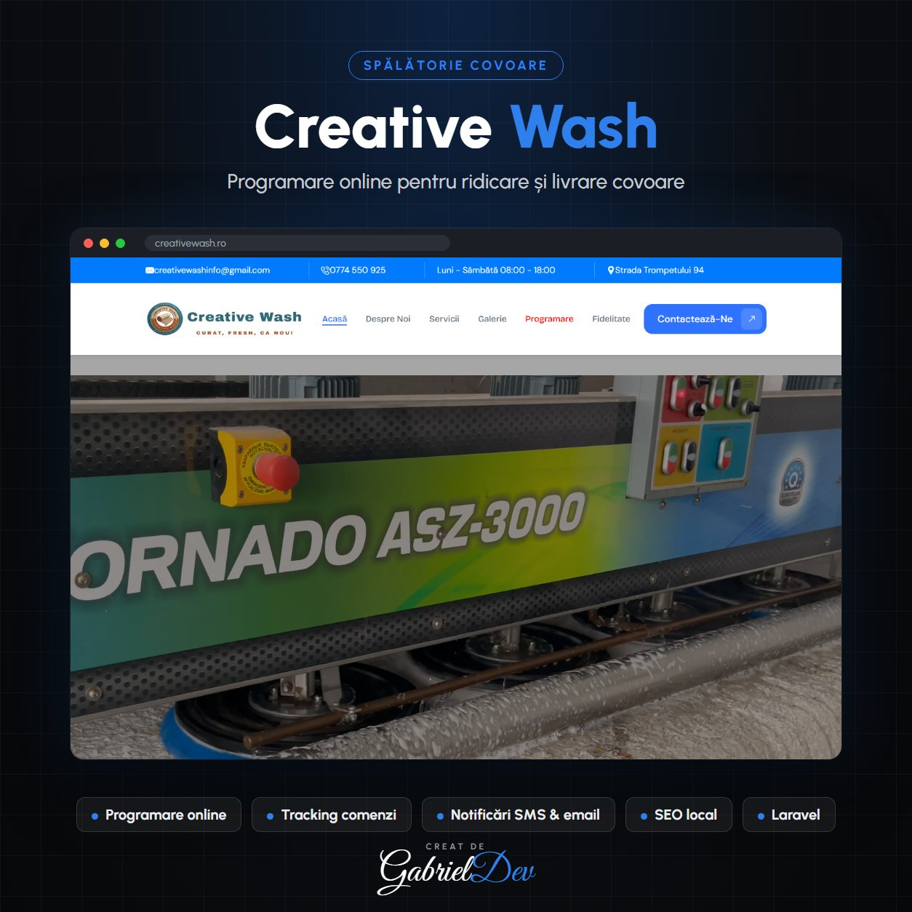

  

<h1 align="center">Creative Wash - Spalatorie Covoare</h1>

Acest proiect reprezintă o platformă modernă pentru o spălătorie de covoare în București. Sistemul permite clienților să programeze ridicarea și livrarea covoarelor rapid și ușor, oferind o experiență online simplificată și intuitivă.

| | |
|---|---|
| **Client** | Client privat |
| **An** | 2025 |
| **Domeniu** | Backend Development · Frontend Development · Aplicații Web Personalizate |
| **Status** | Live — [www.creativewash.ro](https://www.creativewash.ro) |
| **Studiu de caz** | [gabrieldev.eu](https://gabrieldev.eu/portofoliu/creative-wash-spalatorie-covoare) |

---

Descriere

Acest proiect reprezintă o platformă online pentru servicii de curățare profesională a covoarelor. Platforma permite programarea rapidă a ridicării covoarelor, urmărirea stadiului curățării și programarea livrării la domiciliu, oferind clienților o experiență comodă și eficientă.

#### Servicii Cheie

- Programare Online: Rezervare rapidă pentru ridicare și livrare covoare, cu confirmare instant.
- Curățare Profesională: Spălare mecanizată, uscare rapidă și eliminarea petelor și mirosurilor neplăcute.
- Servicii Personalizate: Tratamente speciale pentru covoare delicate, pătate sau cu mirosuri persistente.
- Notificări și Tracking: Urmărirea statusului curățării și notificări pentru livrare și ridicare.
- Sfaturi & Recomandări: Instrucțiuni de întreținere pentru a prelungi viața covoarelor.

#### Tehnologii Folosite

- Front-End: Website modern, intuitiv și responsive pentru o experiență ușoară pe desktop și mobil.
- Back-End: Laravel pentru gestionarea comenzilor, programărilor și notificărilor.
- Database: MySQL pentru stocarea comenzilor, programărilor și detaliilor clienților.
- API Integration: Integrare cu servicii de livrare și notificări SMS/email.

#### Design & Experiență

- Design Modern & Profesional: Interfață curată și atractivă pentru a inspira încredere clienților.
- UX Optimizat: Proces de programare simplificat și ușor de folosit pentru orice client.
- Full Responsive: Compatibilitate completă cu mobil, tabletă și desktop.

---

## 🔒 Despre cod

Acesta este un repository de **prezentare**. Codul sursă aparține clientului și nu este public — aici găsești descrierea proiectului, funcționalitățile și tehnologiile folosite.

## 🤝 Ai nevoie de ceva asemănător?

Proiect realizat de **[Gabriel Dev](https://gabrieldev.eu)** — creare site-uri, magazine online și aplicații web personalizate.

- 🌐 [gabrieldev.eu](https://gabrieldev.eu) · [toate proiectele](https://gabrieldev.eu/proiecte)
- ✉️ [contact@gabrieldev.eu](mailto:contact@gabrieldev.eu)
- 📞 [+40 743 543 100](tel:+40743543100)
